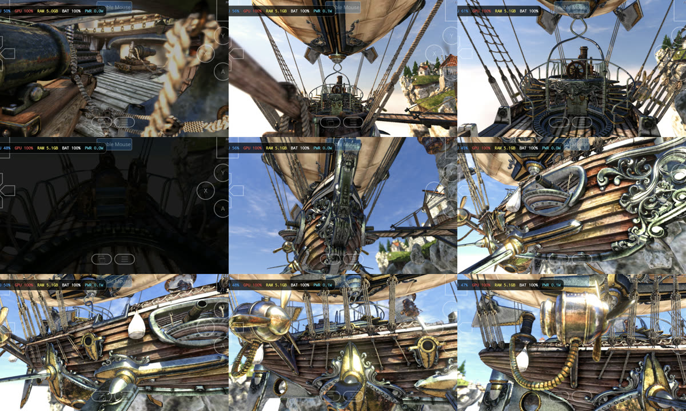
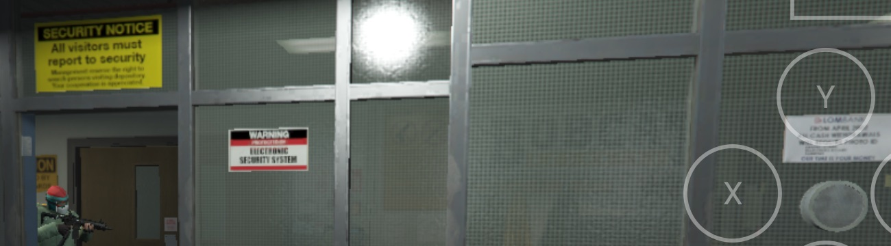
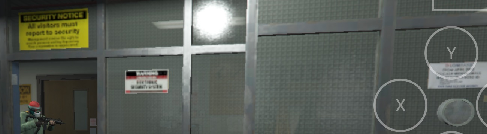

<div align="center">

<h1>xclipse-driver</h1>

<p>
  <b>Turnip for Xclipse.</b> An open-source Vulkan driver for the Samsung Xclipse 940,<br>
  so Windows games run faster, and render correctly, on the Galaxy S24 FE.
</p>

<p>
  
  
  
  
  
  <a href="https://ko-fi.com/aadityavmore"></a>
</p>

<p>
  <a href="#install"><b>Install</b></a>
  &nbsp;·&nbsp;
  <a href="#what-it-does-today"><b>Results</b></a>
  &nbsp;·&nbsp;
  <a href="#quick-start"><b>Build</b></a>
  &nbsp;·&nbsp;
  <a href="docs/PROGRESS.md"><b>Lab notebook</b></a>
</p>

<br>



<sub>Unigine Heaven 4.0 through DXVK in GameNative, on the phone, rendered by this driver.</sub>

</div>

<br>

Adreno phones have Turnip. Xclipse phones have had Samsung's closed driver, stuck at Vulkan 1.3
and missing the features DXVK and vkd3d-proton lean on. This project runs Mesa's RADV on
Samsung's amdgpu-derived `sgpu` kernel driver, building on the radv-xclipse port, and tunes it
for one chip until it beats the stock driver in real games: faster frames, steadier frame times,
less memory pressure, and no rendering defects.

Every number below was measured on a real Galaxy S24 FE (Exynos 2400e), with paired runs,
clock and skin-temperature control, and screenshot review. A run that renders wrongly doesn't
count.

## What it does today

<table>
<tr>
<td width="50%" valign="top">

**More API than Samsung ships**

Vulkan **1.4** with **224** extensions, against the stock driver's 1.3 and 154. BC texture
compression, maintenance5/6 and mutable descriptors, which DXVK 2.x/3.x and vkd3d-proton use,
are all there.

</td>
<td width="50%" valign="top">

**Faster where it counts**

Turning NGG primitive culling off on the 940 gave Heaven **+28% average FPS** and **+22% 1%-low
FPS** over five clock-locked pairs, with no visual change; it is now the default. Pipelines compile **2.5–3.6×** faster
than on the stock driver.

</td>
</tr>
<tr>
<td valign="top">

**Renders what stock can't**

Samsung's driver fails Heaven's D24 depth texture on the current GameNative build. This driver
runs it with correct textures and zero GPU faults, and samples BC textures natively.

</td>
<td valign="top">

**Hardware bugs, found and fixed**

GL1 cache coherence (the blue "lightning" streaks), point-sampled 16/32-bit formats (filtered in
the shader instead), queries without GDS, GFX11 streamout through NGG, a wave64 register clobber,
and GFX11 shader-setup page faults.

</td>
</tr>
</table>

All 22 on-device tests in `pipeline/run.py` pass on both drivers: instance, submit, compute,
rendering, textures (BC1–7, cubes, mips), MRT, vertex fetch, depth/stencil, storage images,
tessellation, scratch, queries and transform feedback.

| Driver-level comparison | vs Samsung's driver |
|---|---|
| FP32 throughput, fill rate, bandwidth | equal |
| Pipeline compile time | 2.5–3.6× faster |
| Tiny-draw CPU cost | 1.6–2× higher (being worked on) |
| Graphics scratch | 3× slower (being worked on) |

In a real game, GTA V, this driver matches Samsung's average frame rate with **69% higher 1%
lows**, loads **34% sooner**, uses less GPU, CPU and memory, and renders sharper textures. See
[Games](#games).

### In progress

- **Memory pressure.** Android 17's lmkd kills *Life is Strange: True Colors* while it loads. The
  driver can now ask the kernel's own sgpu Graphic Memory Reclaim to swap idle GPU buffers to
  zram under pressure (`debug.radv_xclipse_gpuswap`, opt-in, being measured).
- **RDNA3 shader features.** Dual-issue VALU (VOPD) and `s_delay_alu` hints for the 940's core,
  opt-in probes awaiting measurement.
- **Small-draw CPU overhead and graphics scratch**, the two places the stock driver still wins.

## Install

Grab `radv-xclipse-*.zip` from `driver/dist/` (or [build it](#quick-start)), copy it to the phone,
then in GameNative: **Settings → Emulation → Driver Manager → Import ZIP from device**. Point the
game's container at it with these settings:

| Setting | Value |
|---|---|
| Graphics Driver | Wrapper → `RADV Xclipse (Mesa 26.3.0-devel-xd-<sha>)` |
| DX Wrapper | DXVK `2.7.1` with `DXVK_CONFIG=dxvk.enableDescriptorBuffer=False` |
| BCn Emulation | `none` (the driver samples BC natively) |
| Container | `bionic`, FEXCore `Intermediate`, Box64 `Compatibility` |

[`docs/package.md`](docs/package.md) has the full steps, why each setting is there, and every
switch the driver exposes. It is built for the Galaxy S24 FE (Xclipse 940) only.

## Games

Settings that get each game running on this driver, with what each one fixes. The container
exports in [`docs/games/`](docs/games/) hold every other value. GameNative's import replaces a
container's settings wholesale, so compare against them rather than importing them over a working
container.

### Grand Theft Auto V (legacy, DirectX 11)

| Knob | Value | Why |
|---|---|---|
| Graphics Driver Version | `RADV Xclipse (Mesa 26.3.0-devel-xd-4f88558)` or newer | |
| BCn Emulation | **`none`** | With `auto` or `full`, GameNative's wrapper maps and unmaps buffer memory DXVK keeps mapped; the unmap tears down DXVK's mapping and the game crashes on a write fault while loading. |
| DX Wrapper | DXVK `2.7.1`, `DXVK_CONFIG=dxvk.enableDescriptorBuffer=False` | DXVK 2.7.1 faults at startup with descriptor buffers on |
| Wine / Container | `proton-10.0-arm64ec-2`, `bionic`, FEXCore `Intermediate`, Box64 `Compatibility` | |
| Max Device Memory | 512 MB | |
| Screen Size | Custom **1404x648** | The phone's 19.5:9 shape at about 720p's pixel count, so the picture fills the screen without stretching |
| Game resolution | `commandline.txt` in the game folder: `-width 1404 -height 648 -fullscreen` ([copy](docs/games/GTAV.commandline.txt)) | Without it the game opens at 800x600 in the screen's top-left corner |
| Executable | `PlayGTAV.exe`, no arguments | |
| `WINEDLLOVERRIDES` | `version=n,b` | Loads the game folder's own `version.dll` before Wine's; without it the game stops at an incomplete-installation error |
| Quiet logging | `WINEDEBUG=-all`, Wine debug logs off | Logging slows loading |
| Game files | Verify them | A missing `x64/audio/sfx/INTERACTIVE_MUSIC.rpf` crashed the game on a breakpoint instruction with no hint of the cause |

It reaches the prologue in 1.5-3 minutes from launch. `pipeline/game_input.py play GTAV` starts
it and waits for the first playable shot.

**Against Samsung's driver** (2026-10-29, [`results/20261029-113104-play`](results/20261029-113104-play/summary.md)).
Three rounds per driver, taking turns, each launched cold and measured for 60 s in the
prologue's first playable shot, with the phone cooled to the same temperature before each run.
Samsung's driver ran with BCn Emulation `full`, its working setting.

| | This driver | Samsung's driver | Difference |
|---|---|---|---|
| Launch to gameplay | **133 s** | 200 s | 34% sooner |
| Average FPS | 31.1 | 30.7 | the same (both at the game's ~31 FPS ceiling here) |
| 1% low FPS | **15.0** | 8.9 | +69% |
| Stutters per minute | 17.7 | 21.0 | -16% |
| GPU busy | **55%** | 76% | less work for the same frames |
| Big-core (X4) CPU clock | **1121 MHz** | 1654 MHz | -32% |
| GPU memory (peak) | **800 MB** | 894 MB | -11% |
| Skin temperature (peak) | **40.4 C** | 42.7 C | 2.3 C cooler |
| Texture detail | sharp | blurred signs, missing lettering on frosted glass | see below |

Both drivers deliver the same average frame rate, a ceiling the GPU doesn't reach (neither is
fully busy). Our driver reaches it with less GPU and CPU work, fewer frame-time dips, less memory
and a cooler phone. Battery drain wasn't measured; the phone was on USB power. Samsung's driver
also renders this scene with visibly lower texture detail. Its likely cause, unconfirmed, is
GameNative decoding BC textures on the CPU, which also fits its slower load and higher CPU clock.
In 1 of 3 launches, our driver logged one GPU page fault in GTA V's launcher process, before the
game itself starts. The game was unaffected, and the cause is still open.

This driver (top) and Samsung's (bottom), the same frame of the same scene:




### Life is Strange: True Colors (DirectX 11)

Measured with `xd-299e141`; the game was removed from the phone on 2026-10-28 to make room for
GTA V. **Samsung's driver can't run it natively:** the game's textures are 98.7% BC5, which
Samsung's driver doesn't support, so the game stops at a failed `CreateTexture2D` (E_INVALIDARG).
Samsung's driver with GameNative's software BC decode wasn't tried for this game.

| Knob | Value | Why |
|---|---|---|
| Graphics Driver Version | `RADV Xclipse (Mesa 26.3.0-devel-xd-299e141)` or newer | |
| BCn Emulation | `none` | The driver samples BC textures natively |
| DX Wrapper | DXVK `2.7.1`, `DXVK_CONFIG=dxvk.enableDescriptorBuffer=False` | |
| Wine / Container | `proton-10.0-arm64ec-2`, `bionic`, FEXCore `Intermediate`, Box64 `Compatibility` | |
| Max Device Memory | 512 MB | |
| Screen Size | 1280x720 | |
| Exec Arguments | `-nostartupmovies -dx11` | Skips the intro videos; forces the DirectX 11 renderer |
| In-game graphics | Lowest preset, 80% resolution, dynamic resolution on ([GameUserSettings.ini](docs/games/LifeIsStrange3.GameUserSettings.ini)) | |

The first scene after Continue runs at **21-26 FPS** with 1% lows of 6-8 FPS: the GPU sits at its
thermal cap near 300 MHz, so energy per frame decides the frame rate. Android's low-memory killer
may stop GameNative while that scene loads; closing background apps first helps
(`game_input.py play LifeIsStrange3` does it). Container export:
[`LifeIsStrange3.container.json`](docs/games/LifeIsStrange3.container.json).

## Quick start

Every step works on Windows, macOS, and Linux. Set up the toolchain once (it goes into `tools/`, see `tools/README.md`):

```bat
powershell -NoProfile -ExecutionPolicy Bypass -File tools\setup.ps1
```

```sh
sh tools/setup.sh
```

The reference sources are pinned submodules. Restore their exact revisions after cloning or pulling:

```powershell
.\tools\python\python.exe pipeline\sync_sources.py
```

On macOS/Linux, use `tools/python/bin/python3 pipeline/sync_sources.py`. This keeps the kernel's
Windows-safe sparse checkout and restores GameNative's and DXVK's nested dependencies. Use `--only gamenative`
for just the app source. The matching official APK URL and SHA256 are recorded in
[`third_party/gamenative-release.json`](third_party/gamenative-release.json); the other pins are in
[`third_party/MANIFEST.md`](third_party/MANIFEST.md).

Build the driver. On Windows, in a cmd window:

```bat
call tools\env.cmd && driver\build.cmd
```

From PowerShell, run the environment setup and build in the same cmd process:

```powershell
cmd /d /c "call tools\env.cmd && driver\build.cmd"
```

On macOS or Linux:

```sh
. tools/env.sh && driver/build.sh
```

The output is `driver/dist/radv-xclipse-*.zip`. Install it through an emulator's custom GPU driver setting; [`docs/package.md`](docs/package.md) has the GameNative steps, the validated container settings and the driver's switches.

Run the phone tests (USB debugging on, this computer authorized). The Python is `tools\python\python.exe` on Windows and `tools/python/bin/python3` on macOS and Linux (or `python3` after `. tools/env.sh`):

```sh
tools/python/bin/python3 pipeline/run.py
```

Each test runs on both Samsung's driver and ours. The report goes to `results/<time>/summary.md`. Options:

- `--build-driver` rebuilds the driver first.
- `--tests info,device,submit,compute,render` picks tests.
- `--drivers stock,radv` picks drivers.
- `--keep-going` keeps testing our driver even after it made the phone reboot.

## Working with Claude Code or Codex

Open this repository folder in either tool, or run your installed `claude` or `codex` CLI from the repo root. Both use the same portable toolchain, build scripts, and phone-test pipeline.

- [AGENTS.md](AGENTS.md) is the shared source for project instructions, commands, device rules, and commit conventions. Codex [loads it automatically](https://learn.chatgpt.com/docs/agent-configuration/agents-md).
- [CLAUDE.md](CLAUDE.md) [imports](https://code.claude.com/docs/en/memory#import-additional-files) `AGENTS.md`, so edits to the shared guidance apply to Claude Code too. Start a fresh session after changing the instructions.
- [.claude/settings.json](.claude/settings.json) holds Claude-specific settings. Codex uses its own model, permission, and integration settings; no repo-local Codex configuration is needed for these instructions.
- [docs/PROGRESS.md](docs/PROGRESS.md) and [docs/HANDOFF.md](docs/HANDOFF.md) carry project state between tools and computers. Read the latest progress entries after the handoff, and update the handoff only when the user says they are leaving the device.

Check `git status` when switching tools and coordinate concurrent edits. Only one process or agent may drive or test the phone at a time.

To check the pipeline entry points without a connected phone, run these from PowerShell after toolchain setup:

```powershell
.\tools\python\python.exe pipeline\run.py --help
.\tools\python\python.exe pipeline\game.py --help
```

On macOS or Linux, use `tools/python/bin/python3` in place of `.\tools\python\python.exe`.

## Layout

- `driver/`: the RADV port. It's JimVulkan's radv-xclipse with yoro1836's Xclipse 940 bring-up (MIT, based on Mesa), imported with `git subtree`.
- `tests/`: the on-device test harness (`xdtest.c`) and its shaders.
- `pipeline/`: the build, deploy, and test runner.
- `results/`: one folder per test run.
- `docs/`: progress, device findings, and research.
- `tools/`: the portable toolchain, not in git. See `tools/README.md`.
- `third_party/`: pinned reference submodules and the official GameNative APK lock. See `third_party/MANIFEST.md`.

## Support

This is a one-person project, built and benchmarked on my own phone. If it makes your games run
better, the [tip jar](https://ko-fi.com/aadityavmore) keeps it going.

<a href="https://ko-fi.com/aadityavmore"></a>

## Credits

Built on [Mesa](https://mesa3d.org)'s RADV, JimVulkan's radv-xclipse port and yoro1836's Xclipse
940 bring-up. Hardware knowledge comes from Samsung's GPL kernel source, MIT-licensed ports and
our own probing, never from decompiled vendor code. The driver keeps Mesa's licences; see
[`driver/LICENSE`](driver/LICENSE).
